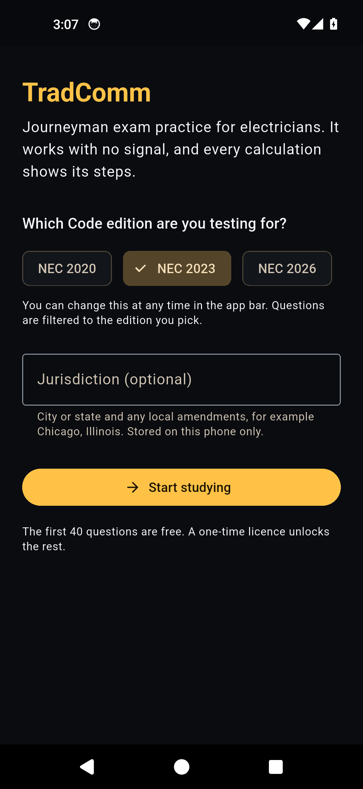
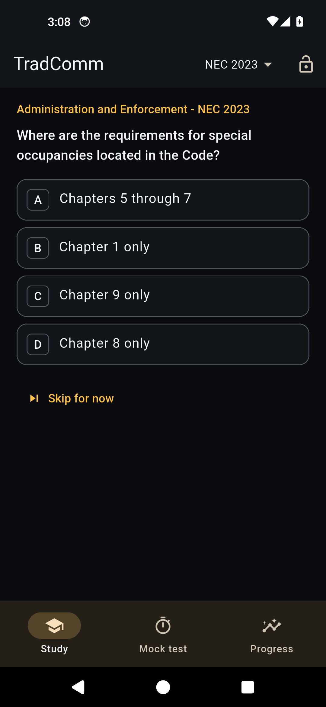
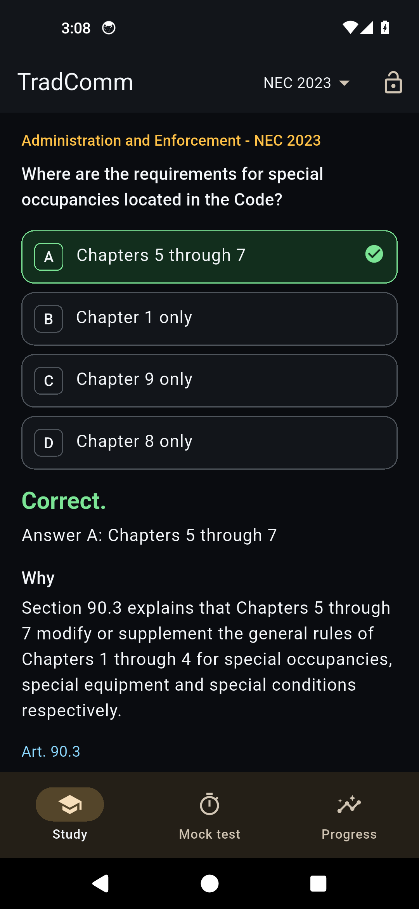
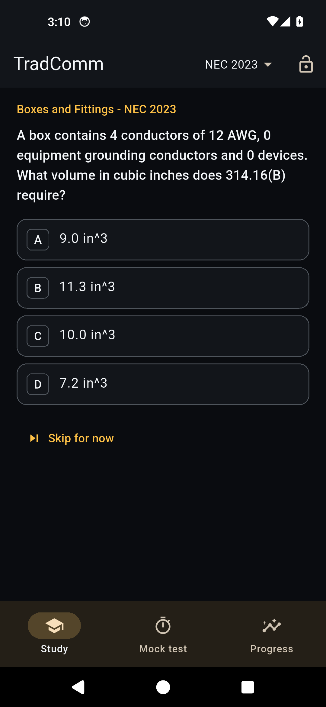
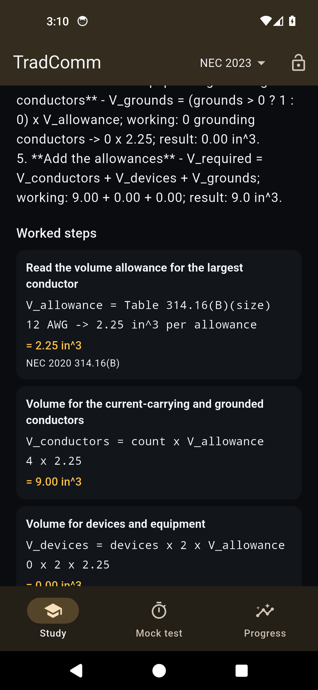
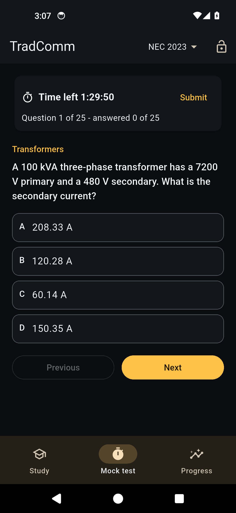
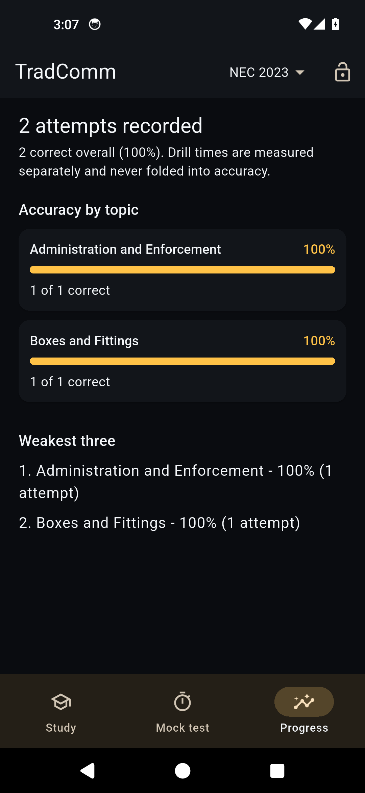
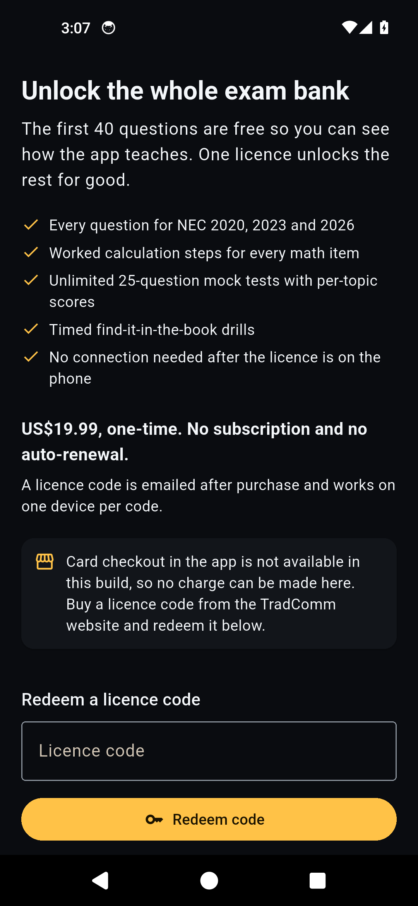

# TradComm

Journeyman exam practice for electricians, on Android. It works with no signal,
and every calculation question shows its working: the rule, the formula, the
numbers substituted, the result, and the article or table it comes from.

Built for the way the open-book exam is actually sat - finding the article fast,
doing code math in a repeatable sequence, and knowing which topics let you down.

| Onboarding | Study | Answer and explanation |
|---|---|---|
|  |  |  |

| Calculation question | Worked steps | Mock exam |
|---|---|---|
|  |  |  |

| Progress dashboard | Licence |
|---|---|
|  |  |

## Install

Download the APK from [Releases](../../releases), then either:

- **On the phone:** open the file and allow installs from your browser or file
  manager when Android asks.
- **Over USB:** `adb install tradcomm-0.1.0.apk`

Requires Android 7.0 (API 24) or newer. It is a single universal APK, so it
installs on arm64, arm32 and x86_64 devices.

Verify the download if you want to (the checksum is published on every release):

```sh
sha256sum tradcomm-0.1.0.apk
# Windows:
certutil -hashfile tradcomm-0.1.0.apk SHA256
```

## What it does

- **300 questions** across fifteen NEC topics, split between concept items and
  calculation items.
- **Code cycle toggle** for NEC 2020, 2023 and 2026 - questions are filtered to
  the edition you are sitting.
- **Worked steps** on every calculation: no "see Article 250.66" dead ends.
- **25-question mock test** with a 90-minute countdown, per-topic scoring, and
  resume if the app is closed mid-test.
- **Progress dashboard**: accuracy by topic, attempts, and the weakest three.
- **Timed book drills**: find an article in your physical code book, timer stops
  when you tap it. Lookup speed is tracked separately from quiz accuracy.
- **Works offline.** The question bank ships inside the app.

## What is free, and what is not ready yet

- The **first 40 questions are free**, counted by question, never by attempt.
- The rest of the bank needs a licence code. **Purchasing is not open yet** -
  this build has no checkout, and codes are not on sale. When sales open, a code
  will be redeemable on the licence screen.
- Licence codes are good for one device and do not expire. There is no
  subscription and nothing auto-renews.

## Current limitations, stated plainly

- This is an **alpha**. `0.1.0` is signed with a development key, not a
  production key, and is not in any app store.
- **Question citations have not yet been independently reviewed.** A licensed
  electrician review pass is in progress. Until it completes, treat explanations
  and article references as study aids that still need checking against your code
  book, not as authoritative answers.
- In this build the app has no reachable server, so content updates and licence
  redemption do not work yet. Offline study and the 40 free questions do.
- No accounts, no cloud sync, no analytics, no advertising.

## Privacy

- No account and no sign-up.
- Your study history, attempts and licence state are stored only on the device.
- The app sends nothing to us in this build. When content sync is enabled, the
  requests are limited to fetching the question bank and checking a licence
  code; nothing profiles you.
- The jurisdiction note you type during onboarding is stored on the device and
  is not transmitted.

## Independence

TradComm is not affiliated with, endorsed by, or sponsored by the National Fire
Protection Association. The National Electrical Code and NFPA 70E are
copyrighted works of the NFPA. This app references them by article and table
number and does not reproduce code text or table bodies.

## Licence

The application and its content are licensed under the Functional Source
License 1.1, MIT Future License (FSL-1.1-MIT); see [LICENSE.md](LICENSE.md).
Each version becomes MIT-licensed two years after its release.

Third-party components and their licences are listed in
[THIRD-PARTY-NOTICES.md](THIRD-PARTY-NOTICES.md).

## For developers

This repository is the distribution channel: release assets, screenshots and
user documentation. How each build was produced - toolchain versions, the
source commit, the signing key used, and how to verify the artefact - is in
[BUILD.md](BUILD.md), kept separate from this page on purpose. Release history
is in [CHANGELOG.md](CHANGELOG.md).
